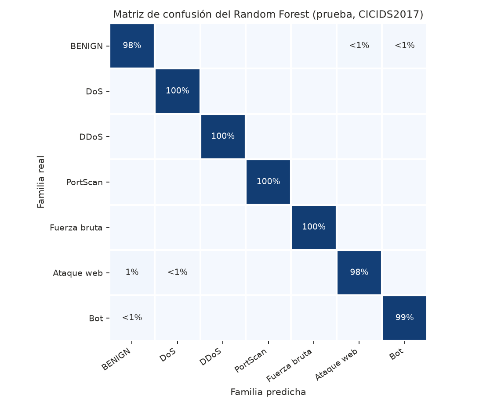

# Clasificación de ataques: resultados (25/11/2026)

La clasificación tiene dos partes, en este orden de prioridad:

1. **Reglas por ventana de tiempo e IP** (`src/clasificacion/reglas.py`). Miran juntos los flujos de
   cada IP en los últimos 10 s y nombran el ataque: escaneo de puertos (al menos 15 puertos distintos),
   ráfaga de conexiones (al menos 50 conexiones TCP cortas al mismo puerto) y transferencia masiva
   (descarga de al menos 20 KB marcada por el modelo, o al menos 5 MB acumulados en la ventana).
   Agrupan los flujos de cada ataque en **incidentes**.
2. **Random Forest multiclase** (`src/clasificacion/modelo_ataques.py`), entrenado con CICIDS2017 y las
   mismas 10 características. Solo se consulta para flujos ANOMALO que ninguna regla explica.

## Random Forest en CICIDS2017

`python scripts/entrenar_clasificador_ataques.py` (44 s). Se usaron los 8 CSV, con como máximo 40.000
flujos por familia, una división 80/20 estratificada y semilla 42. Infiltration (36 flujos) y
Heartbleed (11) quedaron fuera porque son demasiado pocos.

| Familia | Precision | Recall | F1 | Flujos de prueba |
|---|---|---|---|---|
| BENIGN | 0,996 | 0,981 | 0,988 | 8.000 |
| DoS | 0,996 | 0,998 | 0,997 | 8.000 |
| DDoS | 1,000 | 0,999 | 0,999 | 8.000 |
| PortScan | 0,999 | 0,998 | 0,999 | 8.000 |
| Fuerza bruta | 0,996 | 0,999 | 0,998 | 1.481 |
| Ataque web | 0,853 | 0,981 | 0,913 | 420 |
| Bot | 0,874 | 0,992 | 0,930 | 386 |

Exactitud: **99,4 %**. F1 macro: **0,975**. La característica más importante es `Destination Port`
(0,24): el modelo aprende en buena parte **qué puerto** ataca cada familia en ese dataset.

**Advertencia:** la prueba es otro 20 % de los mismos días y de la misma red, así que mide la
separación de familias *dentro* de CICIDS2017, no cómo se comporta en otra red.

### Aplicado al tráfico real del laboratorio (`sesion_laboratorio.csv`)

| Tráfico de PC2 | Flujos | Familia asignada por el Random Forest |
|---|---|---|
| Descarga grande (ataque simulado) | 1.642 | BENIGN 100 % |
| Ráfaga (ataque simulado) | 2.771 | BENIGN 2.732 · no evaluable 39 |
| Descarga pequeña (normal) | 297 | BENIGN 291 · Bot 6 |
| Ping (normal) | 5 | Fuerza bruta 5 |
| Otro (normal) | 15 | BENIGN 11 · no evaluable 4 |

Hay un **cambio de dominio**: el modelo aprendió de otra red y en el laboratorio no reconoce los
ataques simulados. Por eso en vivo mandan las reglas. El ping y las descargas pequeñas no llegan a
consultarse, porque el Random Forest solo se usa con flujos ANOMALO.

## Reglas sobre la sesión real PC1–PC2 (Wi-Fi, 4.730 flujos)

`reportes/sesiones/2026-11-25_escenario_mixto/` (regenerado con `scripts/analizar_sesion.py`).

| Tráfico de PC2 | Flujos | Sin etiqueta | Ráfaga | Transferencia masiva |
|---|---|---|---|---|
| Descarga pequeña (normal) | 297 | 297 | 0 | 0 |
| Ping (normal) | 5 | 5 | 0 | 0 |
| Otro (normal) | 15 | 15 | 0 | 0 |
| Descarga grande | 1.642 | 0 | 0 | **1.642 (100 %)** |
| Ráfaga | 2.771 | 98 | **2.673 (96,5 %)** | 0 |

Hubo 7 incidentes, ninguno en el tráfico normal: 2 ráfagas de unas 20 conexiones/s detectadas **solo
por las reglas**, porque el modelo veía cada conexión como normal, y 5 transferencias masivas.
Sistema completo (modelo o reglas): **precision 100 %, recall 97,8 %, FPR 0 %**. Con el modelo solo
era recall 36,1 %. Las 98 conexiones de ráfaga que no se marcan son las primeras de cada ráfaga, antes
de llegar a 50 dentro de la ventana.

## Prueba en vivo por loopback, con escaneo nmap (`prueba_en_vivo_loopback/`)

Fue una captura real con Npcap en `Loopback Pseudo-Interface 1` durante 90 s, con el tráfico de
`trafico_prueba.py`: normal, luego `nmap -sT -p 1-300`, luego normal, luego ráfaga + descargas de
256 KB durante 15 s y, al final, normal.

| Incidente | Duración | Flujos | Detalle | Detectado por |
|---|---|---|---|---|
| Escaneo de puertos | 10 s | 343 | 288 puertos distintos | modelo + reglas (18 flujos ANOMALO) |
| Transferencia masiva | 14 s | 677 | 131,6 MB | modelo + reglas |
| Ráfaga de conexiones | 10 s | 122 | hasta 12 conexiones/s al puerto 8080 | reglas |

No hubo ningún incidente en las fases normales. Es la primera medición del escaneo con nmap contra
la captura en vivo. Se hizo en una sola máquina (loopback), así que conviene repetirla con PC2 por
Wi-Fi.

## Límites

- Los umbrales de las reglas están ajustados al laboratorio. En una red real, un navegador con muchas
  conexiones o una copia de seguridad pueden dispararlos, y un escaneo lento (1 puerto por minuto)
  pasa por debajo de la ventana.
- Solo se validan en vivo los ataques que PC2 puede generar. DDoS real (muchas fuentes), fuerza
  bruta, ataques web y botnets solo se evalúan con el dataset.
- Solo hay estadísticas de flujo, sin contenido: el tráfico cifrado y los ataques que imitan tráfico
  normal no se distinguen.
- La atribución es por IP, así que la suplantación de IP o el NAT la confunden.
