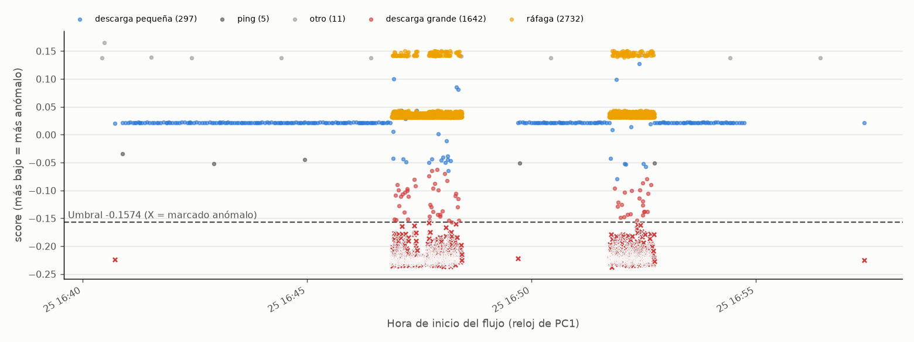

# Sesión 2026-11-25_escenario_mixto

Generado el 2026-11-25 16:58 por `scripts/analizar_sesion.py`.

- Flujos de PC2 (192.168.1.10) capturados en PC1: **4,730**, del
  2026-11-25 16:40:26 al 16:57:25 (reloj de PC1).
- Modelo: base (CICIDS2017), umbral -0.157354 (anómalo si score < umbral).

## Resultado por tipo de tráfico

Cada flujo se clasifica por su forma (puerto y bytes), no por la hora.

| tipo_trafico | flujos | anomalos | no_evaluables | proporcion_anomala | score_medio | score_minimo |
|---|---|---|---|---|---|---|
| descarga pequeña | 297 | 0 | 0 | 0.0% | +0.0199 | -0.0792 |
| ping | 5 | 0 | 0 | 0.0% | -0.0465 | -0.0521 |
| otro | 15 | 0 | 4 | 0.0% | +0.1412 | +0.1379 |
| descarga grande | 1,642 | 1,579 | 0 | 96.2% | -0.2149 | -0.2380 |
| ráfaga | 2,771 | 0 | 39 | 0.0% | +0.0412 | +0.0312 |

## Lectura

- **Descargas grandes (ataque simulado):** 96.2% marcadas como anómalas.
- **Descargas pequeñas (tráfico normal):** 0.0% marcadas (falsos positivos).
- **Ráfaga:** cada conexión por separado es una conexión TCP corta y normal; Isolation Forest
  puntúa flujo a flujo y no ve que llegan cientos por segundo desde la misma IP. Es la
  limitación conocida del modelo (también 0 % en PortScan/DoS de CICIDS2017).
- Tomando como ataque descargas grandes + ráfaga: precision 100.0%,
  recall 36.1%, FPR 0.0%
  (VP 1,579, FP 0,
  FN 2,795, VN 313).

## Gráfica

Cada punto es un flujo; las X son los marcados como anómalos. Sin el CSV de PC2 no se dibujan los tramos.

## Archivos

`flujos.csv` (flujos de la sesión con `tipo_trafico`), `resumen_por_tipo.csv`, `metricas.json` y `puntajes.png`.
